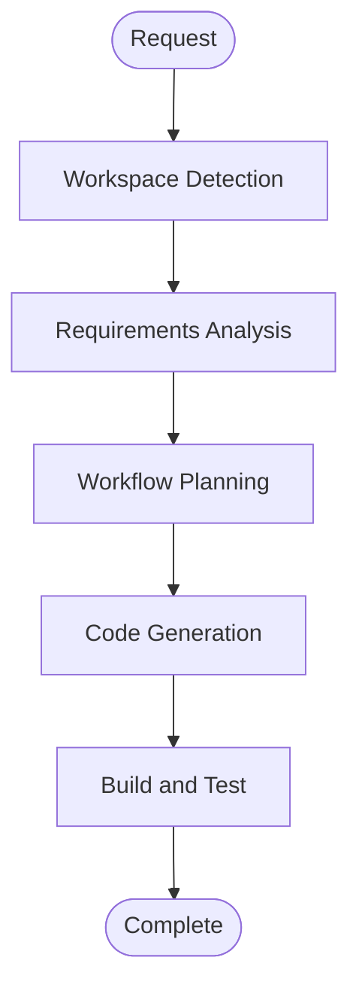

# Execution Plan

## Analysis
- **Scope**: Refactor only the preface and foreword publishing files and their shared presentation.
- **User-facing impact**: None intended; both pages retain their current content and behavior.
- **Structural impact**: Add a reusable content-page layout and simplify the two source pages.
- **Data model/API impact**: None.
- **Risk**: Low; the static site build verifies template and Markdown rendering.

## Workflow Visualization

Text alternative: Workspace Detection -> Requirements Analysis -> Workflow Planning -> Code Generation -> Build and Test -> Complete.

## Stages

### Inception
- [x] Workspace Detection
- [x] Requirements Analysis
- [x] Workflow Planning
- [x] User Stories - Skip; the scoped content-authoring change has clear acceptance criteria and no new user journey.
- [x] Application Design - Skip; no new application component or service is needed.
- [x] Units Planning and Generation - Skip; this is one small change within the existing site.

### Construction
- [x] Code Generation - Execute; add a shared content layout and simplify the two page sources.
- [x] Build and Test - Execute; build the static site and confirm both output routes retain their text and RTL markup.
- [x] Functional Design - Skip; no new business logic or data model.
- [x] NFR Requirements and Design - Skip; no new NFR or infrastructure requirements.
- [x] Infrastructure Design - Skip; deployment configuration is unchanged.

### Operations
- [x] Operations - Skip; no deployment or monitoring changes.

## Success Criteria
- The source of each page is straightforward to edit without hand-written HTML wrappers.
- Existing page titles, routes, text, and RTL styling remain intact.
- `npm run build` succeeds.
